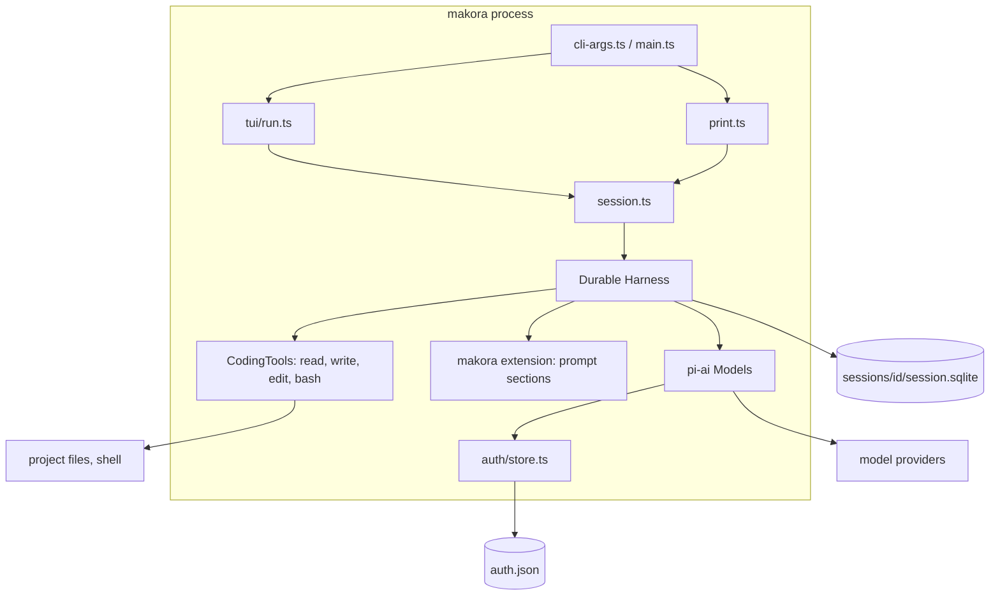

# Architecture overview

Makora is a host application on top of three packages of this monorepo. It adds no runtime of its own: Durable runs
the agent and keeps it durable, pi-ai talks to models, pi-tui draws the screen.



## Packages it builds on

| Package | Used for | Notes |
| --- | --- | --- |
| `packages/durable` (`pi-durable`) | Conversations, tasks, crash recovery, compaction, tools, SQLite storage | Marked experimental upstream; its API can change between releases |
| `packages/ai` (`pi-ai`) | Model catalog, streaming, OAuth and API-key login, token refresh | One change by makora: Anthropic credentials keep account and organization |
| `packages/tui` (`pi-tui`) | Alternate-screen rendering, layout stacks, editor, markdown, key bindings | Used as is |
| `packages/chord` | `Context` for cancellation (`BACKGROUND_CONTEXT`) | Workers come in phase 4 |

Makora does not use `packages/coding-agent` (the `pi` CLI) or the `apps/p2`/`apps/p3` prototypes; it copies small
patterns from p2 (the source resolver, the keybinding declaration merge).

## Process model (phase 1)

One process per `makora` run. The TUI and the Durable harness share it. Tools run as child processes through Durable's
`NodeExecutionEnv` in the session's directory. Phase 2 adds a Python kernel subprocess per conversation; phase 4 moves
sessions into worker processes behind a background service.

## Module map

`apps/makora/src`:

| File | Owns |
| --- | --- |
| `main.ts`, `cli-args.ts` | The command line, parsed into one tagged command, and dispatch |
| `app.ts` | Process-wide state: home paths, auth store, models, settings |
| `paths.ts` | `~/.makora` and the files under it; `MAKORA_HOME` |
| `sessions.ts` | Session directories, `meta.json`, the session list, the writer lock |
| `session.ts` | One open session: lock, `Harness.open`, root conversation, resume, restore notices |
| `settings.ts` | `settings.json`, read live; the harness run policy |
| `models.ts` | Built-in providers plus the scripted fake provider |
| `extension.ts` | The `makora` Durable extension: preamble, cwd, context files, skills |
| `context-files.ts` | AGENTS.md discovery |
| `skills.ts` | Skill discovery, precedence, hidden copies, the prompt section |
| `project.ts` | Directories from cwd to the git root; the branch |
| `tool-cell.ts`, `transcript-rows.ts` | Entries and live state turned into rows and one-line tool summaries |
| `print.ts` | Print mode |
| `auth/` | `types.ts` (contract), `store.ts`, `login.ts`, `usage.ts` |
| `tui/` | See [tui.md](tui.md) |
| `source.ts`, `source-resolver.ts` | Resolve `@earendil-works/*` imports to package sources so nothing needs building |

Other parts of `apps/makora`: `bin/makora.mjs` (launcher), `scripts/sync-skills.mjs`, `skills/` (generated),
`skills-src/` (overlays), `skills.lock.json`, `test/`.

## Files on disk

```text
~/.makora/                      (MAKORA_HOME)
  auth.json                     accounts and credentials, mode 0600
  settings.json                 default model and thinking level
  keybindings.json              optional key overrides
  AGENTS.md                     optional user-wide instructions
  skills/                       optional user skills
  sessions/<id>/
    session.sqlite              Durable storage
    meta.json                   id, cwd, title, timestamps, model
    lock.sqlite, lock.pid       writer lock
```

Phase 2 adds `sessions/<id>/blobs/` for REPL snapshots and `refs/makora/<session>/*` in project repositories
([repl.md](repl.md)).

## Changes outside apps/makora

| Path | Change |
| --- | --- |
| `packages/ai/src/auth/oauth/anthropic.ts` | Keeps `account` and `organization` from the token response, across refresh |
| `packages/ai/src/api/anthropic-messages.ts` | `PI_AI_CLAUDE_CODE_VERSION` overrides the Claude Code version string |
| `scripts/check-pinned-deps.mjs` | Skips `apps/makora/skills` (vendored upstream manifests) |
| `.github/workflows/makora.yml`, `makora-skills.yml` | CI for makora ([development.md](../development.md)) |

Keeping changes to shared packages small keeps merges from upstream cheap.
