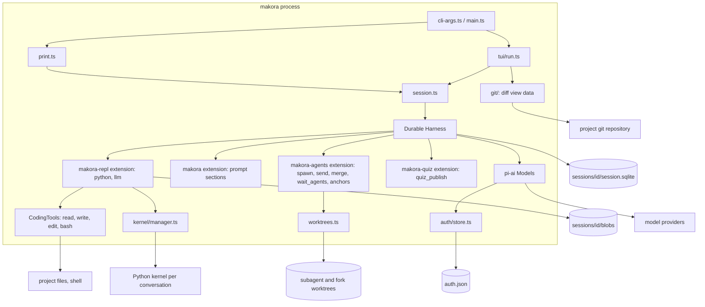

# Architecture overview

Makora is a host application on top of three packages of this monorepo. It adds no runtime of its own: Durable runs
the agent and keeps it durable, pi-ai talks to models, pi-tui draws the screen.



## Packages it builds on

| Package | Used for | Notes |
| --- | --- | --- |
| `packages/durable` (`pi-durable`) | Conversations, tasks, crash recovery, compaction, tools, SQLite storage | Marked experimental upstream; its API can change between releases |
| `packages/ai` (`pi-ai`) | Model catalog, streaming, OAuth and API-key login, token refresh | One change by makora: Anthropic credentials keep account and organization |
| `packages/tui` (`pi-tui`) | Alternate-screen rendering, layout stacks, editor, markdown, key bindings | Used as is |
| `packages/chord` | `Context` for cancellation (`BACKGROUND_CONTEXT`) | Workers come in phase 4 |

Makora does not use `packages/coding-agent` (the `pi` CLI) or the `apps/p2`/`apps/p3` prototypes; it copies small
patterns from p2 (the source resolver, the keybinding declaration merge).

## Process model

One process per `makora` run. The TUI and the Durable harness share it. Tools run as child processes through Durable's
`NodeExecutionEnv` in the conversation's directory. Each conversation that runs a cell has one Python kernel subprocess
in its own process group, talking NDJSON over its stdin and stdout ([repl.md](repl.md)). Subagents are conversations of
the same session in the same process, each with its own kernel in its own worktree ([subagents.md](subagents.md)).
The diff view and the worktree code run `git` as child processes. Phase 4 moves sessions into worker processes behind
a background service.

## Module map

`apps/makora/src`:

| File | Owns |
| --- | --- |
| `main.ts`, `cli-args.ts` | The command line, parsed into one tagged command, and dispatch |
| `app.ts` | Process-wide state: home paths, auth store, models, settings |
| `paths.ts` | `~/.makora` and the files under it; `MAKORA_HOME` |
| `sessions.ts` | Session directories, `meta.json`, the session list, the writer lock |
| `session-delete.ts` | Deleting a session's worktrees, write branches without work, refs and folders: `makora rm` and an ephemeral session's close |
| `session.ts` | One open session, stored or ephemeral: lock, kernels, the git write queue, `Harness.open`, root conversation, resume, restore notices |
| `fork.ts` | Forks: the `makora.fork` document, fork points, creating a fork with its worktree, listing and removing forks; see [forks.md](forks.md) |
| `worktrees.ts` | The git worktrees forks and subagents share: the repository's directory name, the path, adding and removing |
| `agents/` | Subagents: `types.ts` (the record contract), `docs.ts` (documents and signals), `spawn.ts`, `anchor.ts` (the task that drives one child), `worktree.ts` (placement, setup command, committing a write child's work), `control.ts` (merge, stop, remove), `wait.ts` (`wait_agents`, `collect`), `messaging.ts` (`send`), `family.ts` (identity, family, admitting an input), `read.ts` (`agents.*`), `prompts.ts` (the brief, `<agent_result>`, `<agent_message>`), `budget.ts` (the cost stop), `extension.ts` (the `makora-agents` extension); see [subagents.md](subagents.md) |
| `usage.ts` | A conversation's or session's total cost from `pi.usage` |
| `settings.ts` | `settings.json`, read live (model, thinking level, `snapshots`, subagent worktree roots, `agents.maxRunning`, `pstack`) with the warnings parsing it left; the harness run policy |
| `pstack.ts` | pstack model roles: the `code` and `judge` tiers, the role table, the `pstack` block of `settings.json` (parse, defaults, what to store), budgets and thinking clamps, `spawnModel` (what `model="code" \| "judge" \| "provider/id"` runs on), the prompt's role lines |
| `models.ts` | Built-in providers plus the scripted fake provider (`faux-1`, `faux-2`) and its `FAKE_SCRIPTS`; `parseModelRef` |
| `extension.ts` | The `makora` Durable extension: the REPL and subagents preamble, cwd, context files, skills and the pstack role lines |
| `kernel/` | `python-env.ts` (the shared venv), `protocol.ts` (the kernel wire protocol), `kernel.ts` (one kernel process), `manager.ts` (kernels per conversation, status, pid files); see [repl.md](repl.md) |
| `repl/` | `python-tool.ts`, `llm-tool.ts`, `history.ts`, `git-tree.ts`, `details.ts`, `extension.ts` (the `makora-repl` extension); see [repl.md](repl.md) |
| `git/` | `repo.ts` (runs git), `diff.ts` (the diff parser), `log.ts` (the log parser) for the diff view, see [tui.md](tui.md#the-diff-view); `writes.ts` (makora's git writes, one at a time per repository, see [subagents.md](subagents.md#worktrees-and-roots)) |
| `context-files.ts` | AGENTS.md discovery |
| `skills.ts` | Skill discovery, precedence, hidden copies, the prompt section |
| `project.ts` | Directories from cwd to the git root; the branch |
| `tool-cell.ts`, `transcript-rows.ts` | Entries and live state turned into rows and one-line tool summaries, with a python cell's number and nested calls |
| `print.ts` | Print mode |
| `quiz/`, `open.ts` | The session quiz: the bank's checks, the page, the `quiz_publish` tool and `/quiz`'s range ([quiz.md](quiz.md)); the browser opener |
| `auth/` | `types.ts` (contract), `store.ts`, `login.ts`, `usage.ts` |
| `tui/` | See [tui.md](tui.md); the diff view is `tui/diff-*.ts`, the agents dashboard `tui/agents.ts`, `tui/dashboard.ts` and `tui/agent-actions.ts` |
| `source.ts`, `source-resolver.ts` | Resolve `@earendil-works/*` imports to package sources so nothing needs building |

Other parts of `apps/makora`: `bin/makora.mjs` (launcher), `python/makora_rlm/` (the kernel's Python package:
`kernel.py`, `snapshot.py`, `helpers.py`, `protocol.py`), `scripts/sync-skills.mjs`, `scripts/tmux-agents.sh` and
`scripts/tmux-dashboard.sh` and `scripts/tmux-dashboard-scroll.sh` (tmux checks of subagents and the dashboard),
`scripts/tmux-pstack.sh` (tmux check of the `/pstack` picker), `assets/quiz/template.html` (the quiz page),
`skills/` (generated),
`skills-src/` (overlays), `skills.lock.json`, `test/`.

## Files on disk

```text
~/.makora/                      (MAKORA_HOME)
  auth.json                     accounts and credentials, mode 0600
  settings.json                 default model, thinking level, snapshots, subagent worktree roots and limit
  keybindings.json              optional key overrides
  AGENTS.md                     optional user-wide instructions
  skills/                       optional user skills
  python/venv/                  the Python environment every kernel runs in, built on first use
  sessions/<id>/
    session.sqlite              Durable storage
    meta.json                   id, cwd, title, timestamps, model
    lock.sqlite, lock.pid       writer lock
    blobs/sha256/…              pickled REPL variables, one file per blob
    kernels/<conversation>.pid  pid of each running kernel
  worktrees/<repo>-<hash>/<session>/<conversation>/   a fork's or a write subagent's git worktree
  quizzes/<repo>-<hash>/<YYYY-MM-DD>-<n>.html          a quiz page from /quiz
<temp folder>/makora-worktrees/<repo>-<hash>/<session>/<conversation>/   a review subagent's checkout
<project>/.git/
  refs/makora/<session>/<conversation>   commits of the worktree's tree after each cell
  refs/makora/<session>/forks/<conversation>   keeps a fork's starting commit alive
  refs/heads/makora/<name>-<session tail>-<conversation>   a write subagent's branch
<project>/.makora/settings.json   optional `worktreeSetup` command for new subagent worktrees, run once approved
```

An `--ephemeral` session writes none of `sessions/<id>/` and no refs; it still uses `python/venv/`, and a fork it makes
gets a worktree at `HEAD` ([repl.md](repl.md#durability-is-optional), [forks.md](forks.md)). Its worktrees, and its
write branches without work, are removed when it ends. `makora rm <id>` does the same for a stored session and deletes
`sessions/<id>/` and `refs/makora/<id>/` ([features/sessions.md](../features/sessions.md#deleting-a-session)).

## Changes outside apps/makora

| Path | Change |
| --- | --- |
| `packages/ai/src/auth/oauth/anthropic.ts` | Keeps `account` and `organization` from the token response, across refresh |
| `packages/ai/src/api/anthropic-messages.ts` | `PI_AI_CLAUDE_CODE_VERSION` overrides the Claude Code version string |
| `scripts/check-pinned-deps.mjs` | Skips `apps/makora/skills` (vendored upstream manifests) |
| `.github/workflows/makora.yml`, `makora-skills.yml` | CI for makora, with Python 3.12 for the REPL tests ([development.md](../development.md)) |

Keeping changes to shared packages small keeps merges from upstream cheap.
