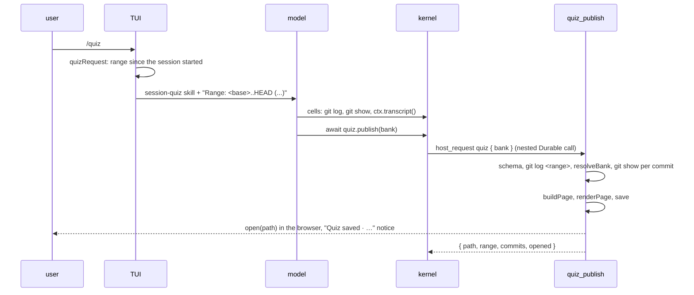

# The session quiz

How `/quiz` is built. What a user sees: [features/quiz.md](../features/quiz.md). Why it is a static page:
[decisions.md](../decisions.md).

## Parts

| Part | File | Owns |
| --- | --- | --- |
| The skill | `apps/makora/skills-src/session-quiz/SKILL.md` | What the agent reads and how it writes the bank; generated into `skills/` like the other overlays ([skills-pipeline.md](skills-pipeline.md)) |
| `/quiz` | `src/tui/commands.ts`, `src/quiz/request.ts` | Resolves the default range and checks a given one, then submits the skill with a `Range:` line |
| The helper | `python/makora_rlm/helpers.py` (`Quiz`) | `await quiz.publish(bank)`: one `quiz` host request |
| The bank | `src/quiz/bank.ts` | `BankSchema`, and `resolveBank`, the checks against the range's commits and diffs |
| Diff rows | `src/quiz/diff-rows.ts` | A file's diff as rows with old and new line numbers, and finding a line on a side: what annotations point into |
| `quiz_publish` | `src/quiz/publish.ts` | Reads the range from git, checks the bank, builds and saves the page, opens it, tells the user |
| The page | `src/quiz/page.ts`, `assets/quiz/template.html` | The page's data (shuffled options, capped diffs, notes on their rows), and the HTML around it |
| The opener | `src/open.ts` | `open`, `xdg-open` or `explorer`; `/login` uses it too |

## From `/quiz` to the page

1. **The range.** `quizRequest` takes the session's start time from its meta. The base is the newest first-parent
   commit of `HEAD` committed before then (`git rev-list -1 --first-parent --before=@<seconds> HEAD`), and the range is
   `<base>..HEAD`, or `HEAD` when every commit is newer. A given range is counted with `git rev-list --count
   --end-of-options <range> --`, so a typo is refused before a turn is spent on it. `all` is passed through: which
   commit starts "the project" is a judgment the skill leaves to the agent.
2. **The hand-off.** The `quiz` host method is one nested call of the `quiz_publish` tool, keyed by the request id, as
   `agents` is ([repl.md](repl.md#host-calls)). The call shows in the cell's nested calls, and Durable checks its
   arguments against `BankSchema` before the tool runs.
3. **The checks.** The tool reads every commit's files with `git show` (`commitFiles` in `src/git/repo.ts`, first
   parent for merges) before it checks anything, because annotations are checked against them. The schema covers the
   shape: 10 questions, 4 non-empty options, `correct` in 0 to 3, a category, at least one cite, annotations with a
   line of at least 1, a side of `new` or `old` and a non-empty comment of at most 600 characters, no unknown fields, a
   range that does not start with `-`. `resolveBank` covers what needs the range: git reads it, it has 1 to 200
   commits, every commit has a summary and every summary key is one commit, a cite that looks like a sha (7 to 40 hex
   digits) is exactly one commit, and no question repeats an option. Each annotation's commit is one of the range, its
   file is in that commit's diff (by new or old path) with a text diff, and `findLine` finds its line on its side among
   the diff's rows; otherwise the error lists the line numbers that side has (`coveredLines`). A cite equal to a
   decision's title (ignoring case) becomes a link to that decision, and one of the form `file:line` a link to the one
   annotation there; a `file:line` that names an annotation which failed its own check adds no second error. Errors from either step reach the cell as
   `HostError`: Durable's message for the schema, and one line per problem, each starting with its field's path, for
   the rest.
4. **The page.** `buildPage` turns each file's diff into rows (`diffRows`: a hunk header, then each line with its
   `oldNo` and `newNo`). It keeps the first 300 rows, and for an annotated line past them the 12 rows either side, so
   an annotation is never hidden by the cap: makora renders that part of the hunk rather than refusing the annotation.
   Rows left out between shown ones become one `gap` row with their count; those after the last shown one are counted
   in `more`. Each note goes on its file with `row`, the index of its line among the shown rows. Annotated files are
   listed first in each commit, and notes are numbered in page order (commits oldest first, files as listed, rows);
   `note` cites are renumbered to match, so `#note-N`, the index, the pill and `n`/`p` all count the same way. Each
   file also gets `focus`, the merged `[from, to]` row ranges of each note's row and 3 rows either side, which **Notes
   only** draws with a `⋯ N lines` marker for what lies between. Each question's options are shuffled with Fisher-Yates over `Math.random`, moving `correct` with the
   right option. `renderPage` reads the template and puts the page's JSON in its one data slot.
   The template draws a file's rows in chunks, each its own horizontal scroller, and ends a chunk at every noted row:
   the note box goes between two chunks, so it spans the file's width and wraps on a phone while the code scrolls. A
   `file:line` cite links to `#note-<index + 1>`; following it opens the commit and the file, draws the file if it was
   not drawn yet, and jumps to the note.
5. **Saving.** The file is `<home>/quizzes/<repo>-<hash>/<YYYY-MM-DD>-<n>.html`, with `<repo>-<hash>` from `findRepo`
   (the main repository's folder name and a hash of its path, as for worktrees) and the first free `n` of the local
   day. The write is exclusive (`wx`), so two quizzes saved at once take different numbers.
6. **Telling the user.** The tool opens the file through the session's opener and announces `Quiz saved · <path> ·
   opened in browser · <range>, N commit(s)` as an `info` session notice. The TUI shows `info` notices as muted `·`
   lines and print mode writes them to stderr the same way; `warning` notices keep the `⚠` box.

## Escaping

The page's data is the model's text (summaries, questions, comments) and the repository's text (subjects, paths,
diffs), so it is untrusted. It reaches the page by one path:

- **In the HTML.** The data sits in ``, `<!-- <script>`, `-->`, `</SCRIPT >` and `$&`, then parses the output: the tags are exactly the
template's, the data script has no angle bracket, and its JSON reads back equal to the page.

## Tests

| Test | Covers |
| --- | --- |
| `test/quiz-bank.test.ts` | The schema per field, and `resolveBank`: summaries by prefix, cites resolved (a `file:line` to its note), annotations on either side and past the cap, every problem listed (a bad commit, file, line or side, a binary file, a cite of no note), a range without commits |
| `test/quiz-page.test.ts` | The shuffle (a permutation, the right option tracked, all 24 orders reached), diff rows and caps, each note on its line's row, a line past the cap shown with its window and a gap, rendering hostile text in every field including comments |
| `test/quiz.test.ts` | The fake model publishing a bank with annotations in a temporary repository: the saved page's questions, diffs and notes, the opener called once, the notice; a bad bank's schema, range and annotation errors reaching the cell with nothing saved; the ranges `/quiz` asks for |

The fake model's first script (`src/models.ts`) answers the session-quiz skill by publishing the bank in
`quiz-bank.json` of the conversation's directory, so a test writes the bank it wants. Tests pass `openBrowser` in the
session's open options; nothing opens a real browser.
