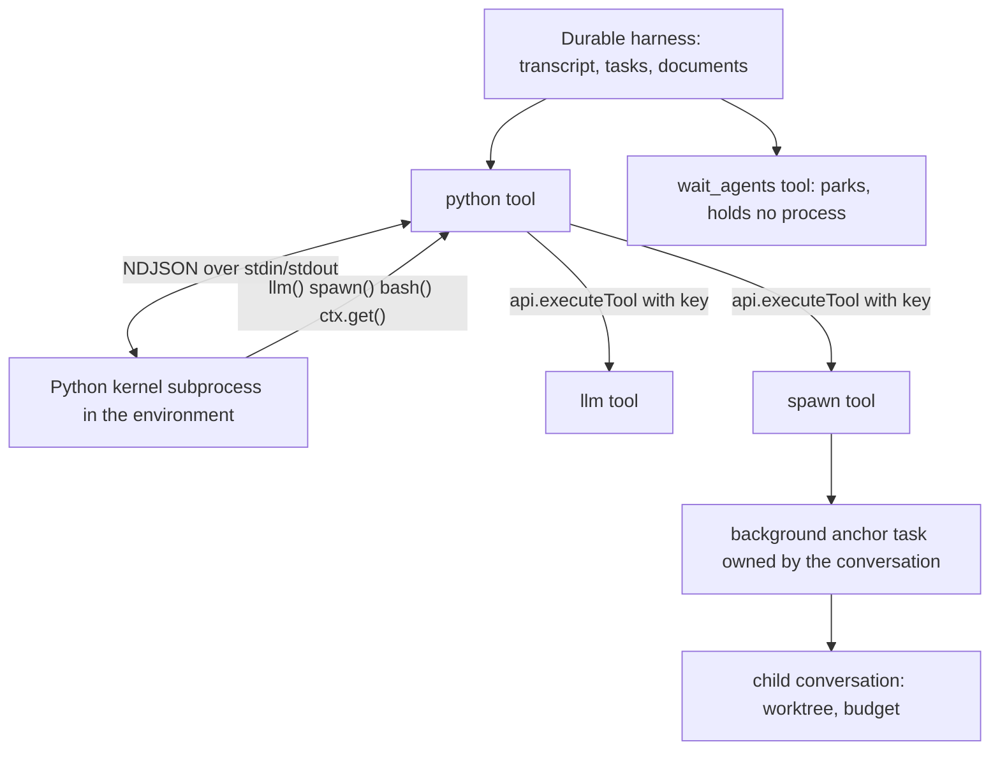

# The Python REPL (phase 2, planned)

> **Status: designed, not built.** This page is the agreed design for phase 2. Decisions behind it are in
> [decisions.md](../decisions.md): the REPL is Python, snapshots are tied to Durable commits, children belong to the
> conversation, pickle blobs are per session.

The model's main tool becomes a persistent Python REPL, following the Recursive Language Model idea: context lives in
variables, and subagents and model calls are functions. Durable keeps everything else durable; the REPL's variables
survive crashes through per-cell snapshots.

## Parts



| Part | Role | Built on |
| --- | --- | --- |
| Kernel manager | One Python process per conversation, started inside that conversation's environment | New. Needs a long-lived process with pipes; Durable's `ExecutionEnv` only has one-off `exec`, pi-env has `openProcess` |
| `python` tool | Sends a cell to the kernel, streams its output, answers the kernel's host requests, commits the result with its snapshot reference | `defineTool`, `api.output`, `api.executeTool` |
| `llm` tool | One model call, optionally schema-checked; no agent loop | Tool with `callers: ["tools"]`, returns `usage` |
| `spawn`, `send`, `list_agents` | Create or reuse a child by name, with worktree, environment and budget | Background anchor pattern (`packages/durable/test/examples/22-subagent-background.ts`), `configure({ cwd, model, tools, maxTurns })` |
| `wait_agents` | Waits for children without holding a process | Parked tool: `{ wait: { on, policy: "any" } }` |
| `ctx` handles | Prompt, files, transcripts and child results as variables loaded on demand | Durable entries and documents, read through host requests |
| `makora_rlm` | Python package: kernel loop, `rlm` API, snapshots | uv-managed virtualenv, own `pyproject.toml` |

Durable itself stays unchanged. The process capability is either added to `ExecutionEnv` (small, offerable upstream)
or defined in Makora with local, Docker and pi-env implementations.

## Using it

The model's main tool is a persistent Python REPL, following the Recursive Language Model idea: context lives in
variables, and subagents and model calls are functions.

```python
data = ctx.get("prompt")                        # loaded on demand; not in model context unless printed
parts = [data[i:i+50_000] for i in range(0, len(data), 50_000)]
notes = [await llm(f"Extract API changes:\n{p}", schema=Changes) for p in parts]

await spawn("fix-auth", "Fix the failing auth tests", worktree=True, budget={"usd": 2, "minutes": 30})
await spawn("fix-db",   "Fix the migration bug",      worktree=True)
# end the cell, then call wait_agents(["fix-auth", "fix-db"]): it parks, holding no process
```

Long computation (training, large builds) runs through background `bash` or `spawn`, not inside a cell, so a crash
costs a cell that started the job rather than one that ran it for an hour.

### Children do not belong to the cell

Durable aborts the nested calls of a tool call that is not replay-safe when it restarts. A Python cell cannot be
replay-safe: running it again repeats its side effects. So `spawn` creates the child under a background anchor task
owned by the conversation, keyed by the child's name. A crashed cell does not touch it, and `spawn("fix-auth")` called
again reattaches instead of starting a duplicate.

## What one cell saves

```text
~/.makora/sessions/<session>/
  session.sqlite        Durable: transcript, tasks, documents, child conversations
  blobs/sha256/…        pickled Python variables (dill, zstd-compressed)
<repo>/.git/objects     git trees and blobs of the worktree, kept alive by refs/makora/<session>/<conversation>
```

At the end of each cell, in this order:

1. **Changed variables** are pickled into `blobs/`, one blob per variable, or per group of variables that share objects
   (`a = b = []` must restore as one list). Unchanged variables write nothing.
2. **The worktree's state** is captured as a git tree with a temporary index (`GIT_INDEX_FILE=<tmp> git add -A && git
   write-tree`), so the real index and branch do not move. Untracked files are included, ignored ones are not. A commit
   wrapping the tree goes under `refs/makora/<session>/<conversation>` so `git gc` does not prune it.
3. **One Durable commit** stores the tool result with the references to both in `details`.

Data is written before the reference to it, so a committed reference always points to existing data. Blobs and trees
written before a crash and never committed are garbage.

```json
{
  "toolName": "python",
  "output": [{ "type": "text", "text": "parsed 1,204 files; 37 API changes" }],
  "details": {
    "kernel": { "cell": 7, "python": "3.12.7", "dill": "0.3.9", "venvLock": "sha256:9f2c…", "cwd": "/repo/.makora/worktrees/fix-auth", "tree": "git:3e9a…" },
    "snapshot": {
      "id": "sha256:4a7d…",
      "parent": "sha256:c1b3…",
      "imports": ["json", "re", "pandas as pd", "from pathlib import Path"],
      "vars": {
        "files": { "blob": "sha256:77e0…", "bytes": 182344, "type": "list[str]" },
        "helpers": { "blob": "sha256:5d20…", "bytes": 2210, "type": "function", "group": ["parse_one", "classify"] }
      },
      "dropped": [{ "name": "conn", "type": "sqlite3.Connection", "reason": "unpicklable" }]
    }
  }
}
```

Calls made during a cell (`llm()`, `bash()`, `spawn()`) are committed as their own nested Durable calls when they
happen, so they survive a later crash of the cell.

### Restore

The harness restores, not the model. On a new kernel, the kernel manager reads the last committed `python` result on
the current branch, imports `imports`, loads the listed blobs, and starts in `cwd`. It compares `tree` with the disk
and tells the model what differs:

```text
kernel died (OOM) during cell 8. Variables restored to after cell 7.
Files changed since cell 7 (not restored): a.py, b.py
Dropped: conn (unpicklable), big (over cap)
```

- A cell that raised a Python exception still commits; restore goes to it, since that is the state the model saw.
- The harness never reruns a cell by itself: the cell may be what killed the kernel, or may have had side effects.
- When Makora itself restarts, a kernel that is still alive is killed and restored from the committed snapshot, so
  the kernel's state matches the transcript. Kernel process IDs are recorded for this.
- Forking a conversation at an entry restores that entry's snapshot.
- On a Python or virtualenv mismatch, function blobs (CPython bytecode) are dropped and reported; plain data usually
  still loads.

### What is not saved

The memory of the cell that crashed; unpicklable or over-cap variables (listed in `dropped`); ignored files; files
outside the worktree, databases and external APIs; running background processes; the virtualenv itself (rebuilt from
its lock).

### Ownership and pruning

- Pickle blobs are per session. Children and forks share the session's Durable storage and so its `blobs/`. Deleting
  a session is removing its directory and its refs. Pruning reads the session's own SQLite and touches nothing else.
- Git objects are per repository by nature; Makora only moves or deletes its own refs and leaves deletion to `git gc`.
- Every cell's reference stays in the transcript. Full blobs are kept for the last N cells, fork points and marked
  cells; older blobs may be pruned, and a restore that needs one reports it as pruned.
- Loading a pickle runs code: `blobs/` is inside Makora's trust boundary and is never imported from elsewhere.

## Crash causes

| Cause | Kills | Mitigation |
| --- | --- | --- |
| Out of memory, native crash, `sys.exit()` | kernel | memory limits on the kernel process; restore from snapshot |
| Code that ignores interrupts (hung socket, subprocess, C loop) | kernel, after timeout | default timeouts on network calls in `rlm` helpers |
| Container stopped, SSH dropped, machine reboot | environment and kernel | kernel runs under the remote daemon (pi-env) |
| Makora crash, upgrade, user kill | host; the kernel may survive | Durable recovery; drain running cells before upgrades |
| Timeout, user abort, budget exceeded | the cell only | the kernel survives; the result says the cell was cut off |

## Open questions

- How to detect unchanged variables cheaply: pickling a large DataFrame after every cell only to hash it is slow.
  Candidates are skipping variables the cell never names, or fingerprints for known types. To be measured.
- Size caps per variable and per snapshot, and N for pruning.
- Where the process capability lives: Durable's `ExecutionEnv` or Makora.
