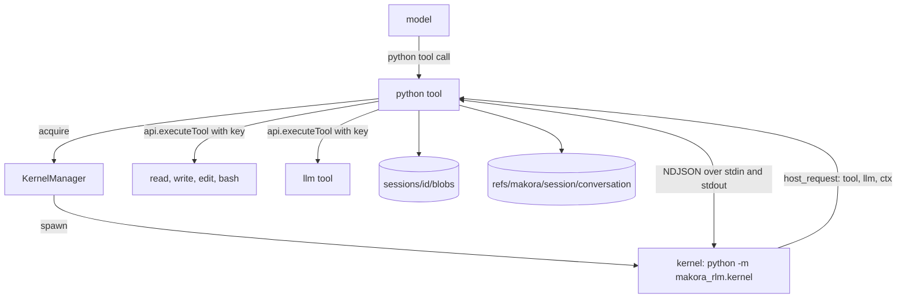

# The Python REPL

> **Status: built (phase 2), except the items in [Not built yet](#not-built-yet).** The decisions behind it are in
> [decisions.md](../decisions.md). What a user sees: [features/repl.md](../features/repl.md).

The model's main tool is a persistent Python REPL, following the Recursive Language Model idea: context lives in
variables, and model calls are functions. Durable keeps the transcript, tasks and tool calls. The REPL's variables
survive kernel crashes and makora restarts through per-cell snapshots tied to Durable commits.

## Parts



| Part | File | Owns |
| --- | --- | --- |
| `makora_rlm` | `apps/makora/python/makora_rlm/` | The Python side. `kernel.py` is the NDJSON loop, output capture, top-level `await` and interrupts. `snapshot.py` pickles and restores. `helpers.py` holds the functions cells call. `protocol.py` mirrors `src/kernel/protocol.ts` |
| Python environment | `src/kernel/python-env.ts` | Builds `<home>/python/venv` once |
| Kernel | `src/kernel/kernel.ts` | One kernel process: spawn, requests and replies, interrupt, kill, exit detection |
| Kernel manager | `src/kernel/manager.ts` | One kernel per conversation, started on its first cell; the status the dock shows; pid files |
| `python` tool | `src/repl/python-tool.ts` | One cell: its number, restore, execute, host requests, snapshot and git tree |
| `llm` tool | `src/repl/llm-tool.ts` | One model call for `await llm(...)` |
| History reads | `src/repl/history.ts` | Finds the restore point; answers `ctx.input()` and `ctx.transcript()` |
| Git trees | `src/repl/git-tree.ts` | Captures the worktree as a git tree and keeps it alive under `refs/makora/...` |
| Result details | `src/repl/details.ts` | The shape of a `python` result's `details` |
| `makora-repl` extension | `src/repl/extension.ts` | Registers `python` and `llm` |

The model is offered `python` and the subagents' `wait_agents` (`modelTools: [python, wait_agents]` in
`src/session.ts`). Opening a session made before them reconfigures its root conversation the same way. The registry still installs Durable's `CodingTools`, so `read`,
`write`, `edit` and `bash` run when a cell calls them, as nested Durable calls, each recorded in its own task.
Durable itself is unchanged.

`python` has `callers: ["model"]`, so no tool can call it. Its `executionMode` is `"sequential"`. Durable then runs the
whole tool round in order, so two `python` calls of one model turn never share a kernel at once. `llm` has
`callers: ["tools"]`, so only cells reach it.

## The Python environment

`ensurePythonEnv` builds one environment per makora home, at `<home>/python/venv`, when the first cell of any session
needs it:

1. With uv: `uv venv --no-config --python 3.12`, then `uv pip install --no-config dill==0.4.1`. uv runs with
   `<home>/python` as its cwd and `--no-config`, so a project's `uv.toml` or `pyproject.toml` cannot change the
   index or the Python it uses.
2. If uv is missing or fails: `python3 -m venv`, then `pip install dill==0.4.1`. This uses whatever version `python3`
   is, which must be 3.11 or newer because the kernel starts with `python -P`. An older one fails with `Python X.Y.Z
   is too old; makora needs Python 3.11 or newer`.
3. If both fail, the cell fails with `makora could not build its Python environment. Install uv
   (https://docs.astral.sh/uv/), or python3 3.11 or newer with venv and pip.` followed by both errors.

The marker file `makora-env.json` in the venv records the dill version. A venv whose marker names another version is
rebuilt. Each build runs in its own temporary directory and is renamed into place, so two makora processes that build
at once both succeed and end up on one venv.

`makora_rlm` is not installed into the venv. Kernels run with `PYTHONPATH` set to `apps/makora/python`.

## The kernel

`Kernel.start` runs `<venv>/bin/python -P -m makora_rlm.kernel` in the conversation's cwd, in its own process group.
A Ctrl+C in the terminal reaches makora only, and killing the group also kills the processes a cell started. `-P`
keeps the project directory off `sys.path` while the kernel imports its own modules, so a project file such as
`json.py` cannot break the kernel. The kernel then puts the project directory first on `sys.path`, so cells import
project modules as `python -m` in the project would.

The kernel keeps the process's original stdin and stdout for the protocol. User code gets `/dev/null` as stdin. Its
stdout and stderr, at both the Python and the file-descriptor level, become `stream` messages, so output from
subprocesses and C code is captured too. On `shutdown`, or when its stdin closes because makora is gone, the kernel
kills its own process group with SIGKILL, so processes its cells started die with it. Start to ready took 53 to
56 ms in the builder's measurement (M-series Mac, Python 3.12.12).

A cell may use top-level `await`. When its last statement is an expression, that expression's `repr` is the result's
`value`, cut at 100,000 characters. Tracebacks start at the cell: the kernel removes its own frames.

### The protocol

One JSON object per line. `src/kernel/protocol.ts` and `python/makora_rlm/protocol.py` define the same shapes; change
both together. `KERNEL_PROTOCOL_VERSION` is 1, and makora refuses a kernel whose `ready` reports another version.

| From | Message | Purpose |
| --- | --- | --- |
| makora | `execute { id, code, timeoutMs }` | Run one cell |
| makora | `interrupt { id }` | Interrupt the running cell |
| makora | `snapshot { id, blobDir, previous, maxVariableBytes }` | Pickle the namespace into blobs |
| makora | `restore { id, blobDir, manifest }` | Load a snapshot into the namespace |
| makora | `host_reply { requestId, ok, value \| error }` | Answer a host request |
| makora | `shutdown` | Exit |
| kernel | `ready { protocol, pid, python, dill }` | First line, once requests are accepted; makora waits 30 s for it |
| kernel | `stream { id, stream, text }` | Cell output, batched every 50 ms and flushed before each reply |
| kernel | `host_request { requestId, cellId, method, params }` | A helper's call into makora: `tool`, `llm`, `ctx`, `agents` or `quiz` |
| kernel | `result { id, status, value?, error?, durationMs, maxRssBytes }` | How a cell ended: `ok`, `error` or `interrupted` |
| kernel | `snapshot_result { id, manifest }` | The snapshot's manifest |
| kernel | `restore_result { id, restored, failed }` | Names restored, and names that failed with the reason |

### Interrupts and timeouts

- A cell's timeout is 600 s unless the model passes `timeout` (seconds). At the timeout the kernel raises
  `KeyboardInterrupt` in the cell, and the result says `cell N timed out after 600s`.
- Esc aborts the tool call's context. makora sends `interrupt`. The kernel raises `KeyboardInterrupt` where the cell
  runs, or cancels it where it awaits.
- A cell that ignores an interrupt for 3 s (`INTERRUPT_GRACE_MS`) is killed with its process group. So is a cell
  still running 3 s past its timeout.
- `sys.exit()` in a cell ends that cell as an error (`SystemExit`). The kernel keeps running.

### Host calls

The helpers in a cell send `host_request` messages, and the `python` tool answers them:

| Method | Answered by |
| --- | --- |
| `tool` | `api.executeTool(name, args, context, { key: requestId })`: a nested Durable call of `read`, `write`, `edit` or `bash`. Durable checks the arguments against the tool's schema |
| `llm` | A nested call of the `llm` tool, keyed the same way |
| `ctx` | `latestInput` or `recentEntries` in `history.ts`, read from the conversation's committed entries |
| `agents` | One nested call of a subagent tool, keyed the same way: `spawn`, `collect`, `send`, `merge`, `stop` or `remove`, or the `agents` tool for `list`, `get` and `recent` ([subagents.md](subagents.md#tools)). The result is the tool's structured output |
| `quiz` | `await quiz.publish(bank)`: one nested call of the `quiz_publish` tool, keyed the same way, which checks the bank, saves the quiz page and opens it ([quiz.md](quiz.md)). The result is `{ path, range, commits, opened }` |

`await read(path)` with neither `offset` nor `limit` returns the whole file. Durable's `read` stops at its line and
byte limits and says so only in a diagnostic, so the python tool follows the continuation offsets, one nested `read`
call per page, keyed `<requestId>@<offset>`. A single line over read's byte limit (51,200 bytes) cannot be continued,
and the call raises `HostError` with `<path>: line N is over read's 51200-byte limit`. With `offset` or `limit`, it
returns one page.

A failed nested call raises `HostError` in the cell. The exception is a call that returned a value for programs:
`bash` with a non-zero exit returns its result, and `exit_code` holds the code. The kernel reads replies on its own
thread, so a reply reaches a cell that blocks in synchronous code, as `ctx.input()` does.

The `llm` tool makes one `completeSimple` call with the conversation's model, or with `model` (`provider/modelId`).
With `schema`, it asks for one JSON value matching the schema, takes the JSON out of a code fence if there is one, and
checks it with pi-schema's `compile`. It returns `usage`, so its cost counts toward the session's.

## What one cell saves

```text
~/.makora/sessions/<session>/
  session.sqlite        Durable: transcript, tasks, documents, the cell counter
  blobs/sha256/…        pickled Python variables, one file per blob
  kernels/<conv>.pid    the pid of each running kernel
<repo>/.git/objects     git trees and blobs of the worktree, kept alive by refs/makora/<session>/<conversation>
```

Cells are numbered per conversation by the `makora.python-cells` Durable document. The python tool increments it in a
commit when the cell starts, so numbers survive crashes and restarts, and a cell that crashed keeps its number. The
running details carry the number, so the TUI shows it while the cell runs.

At the end of each cell, with snapshots on, in this order:

1. **Variables** are pickled into `blobs/` (see [Snapshots](#snapshots)).
2. **The worktree's state** is captured as a git tree with a temporary index. The index starts as a copy of the real
   one, then `git add -A` and `git write-tree` run against it, so the real index and branch do not move. Untracked
   files are included, ignored ones are not. `git commit-tree` wraps the tree in a commit by `makora
   <makora@localhost>` whose parent is the ref's previous commit, and `git update-ref` moves
   `refs/makora/<session>/<conversation>` to it, so `git gc` does not prune it. Outside a git repository there is no
   tree. A failed capture leaves the cell without one.
3. **One Durable commit** stores the tool result with references to both in `details`.

Data is written before the reference to it, so a committed reference always points to existing data. Blobs and trees
written before a crash and never committed are garbage.

```json
{
  "toolName": "python",
  "output": [{ "type": "text", "text": "parsed 1,204 files; 37 API changes" }],
  "details": {
    "kernel": { "cell": 7, "python": "3.12.12", "dill": "0.4.1", "cwd": "/Users/me/repo", "tree": "git:3e9a…" },
    "snapshot": {
      "id": "sha256:4a7d…",
      "parent": "sha256:c1b3…",
      "python": "3.12.12",
      "dill": "0.4.1",
      "imports": ["import json", "import pandas as pd", "from pathlib import Path"],
      "vars": {
        "files": { "blob": "sha256:77e0…", "bytes": 182344, "type": "list[str]" },
        "parse_one": { "blob": "sha256:5d20…", "bytes": 2210, "type": "function", "group": ["classify"] }
      },
      "dropped": [{ "name": "conn", "type": "sqlite3.Connection", "reason": "unpicklable" }]
    },
    "calls": [{ "name": "bash", "args": { "command": "rg -l 'def ' src" }, "isError": false, "durationMs": 212 }]
  }
}
```

`calls` lists the cell's nested calls, at most 50, with string arguments cut to 200 characters. `moreCalls` counts the
rest. Durable keeps nested results only in their own task records, so without `calls` the cell's transcript entry
could not show them. Each nested call is its own Durable commit when it happens, so it survives a later crash of the
cell.

The model sees the cell's output (the last 16,000 characters, with a note on how many came before), then `Out: <repr>`
of the final expression (cut to 4,000 characters), then the traceback of an error (cut to 8,000). A restore notice,
when there is one, comes first.

### Snapshots

`snapshot.take` in `snapshot.py`:

- Names starting with `_` and the injected helpers are skipped.
- Modules, and names bound by a cell's top-level `import` or `from ... import`, are saved as import statements in
  `imports` and replayed on restore, not pickled.
- Variables that reach a common mutable object are saved as one group in one blob, so `a = b = []` restores as one
  list. Finding groups walks each value's object graph with `gc.get_referents`, up to 2,000,000 visited objects in
  total.
- Each group is pickled with protocol 5 by Python's C pickler. Functions and classes defined in the REPL itself make
  the C pickler give up, because it would save them by name, and those groups fall back to dill, which saves them by
  value. Both write the same bytes for plain data, so a value keeps its blob whichever pickler wrote it. A member that
  neither can pickle is dropped as `unpicklable`. The rest of its group is still saved.
- A group whose pickle is larger than 64 MiB (`MAX_VARIABLE_BYTES`) is dropped as `over_cap`.
- A blob's name is `sha256:<hex>` of its bytes, stored at `blobs/sha256/<first two hex>/<rest>`, written to a
  temporary file and renamed. A blob the previous snapshot already lists is not written again. Change is decided by
  that hash, so an unchanged variable is still pickled after every cell.
- The snapshot's `id` is the SHA-256 of its manifest. `parent` is the `id` of the snapshot the kernel last saved or
  restored.

Costs measured by the builder (M-series Mac, Python 3.12.12, dill 0.4.1, script `/tmp/makora-repl/measure.ts`):

| Value | Pickled size | Snapshot | Snapshot, unchanged | Restore |
| --- | --- | --- | --- | --- |
| List of 1e6 ints | 4.9 MB | 20 ms | 18 ms | 13 ms |
| List of 1e7 ints | 49.9 MB | 258 ms | 193 ms | 133 ms |
| 50 MB `str` | 52.4 MB | 58 ms | 25 ms | 37 ms |

For the 1e7 list, finding groups took 101 ms, pickling 54 ms, hashing 16 ms and the write 12 ms. Loading the pickle
costs about 139 ms with either loader. dill's own pickler is written in Python. It took 3.6 s for the same list, which
is why snapshots use the C pickler first.

### Restore

The harness restores, not the model. A kernel started for a cell (none ran yet in this process, or the last one died)
first goes through `prepareKernel`:

1. `findRestorePoint` scans the conversation's entries, newest first, for the newest committed `python` result whose
   details hold a snapshot.
2. No python result at all: nothing to restore.
3. Snapshots are off: the kernel starts empty, and the cell's output starts with `Kernel restarted empty: variables
   of earlier cells were lost (snapshots are off).` Snapshots are on, but no earlier python result holds one: the
   kernel starts empty with `Kernel restarted empty: no earlier cell saved a snapshot, so their variables were
   lost.`
4. Otherwise the kernel replays `imports`, then loads each blob with dill. A blob that is missing, fails its hash
   check, or holds a function or class from another Python minor version is reported per name. If the kernel dies
   while restoring, makora starts an empty kernel with `Kernel restarted empty: restoring the snapshot of cell N
   killed the kernel (...); variables were lost.`
5. When the snapshot's cell has a tree, makora captures the worktree now and lists the files that differ
   (`git diff-tree -r --name-only`).

The notice is the first part of the cell's output, which the model reads:

```text
Kernel restarted. Variables restored to after cell 7: files, parse_one, classify.
Files changed since cell 7 (not restored): a.py, b.py
Dropped: conn (unpicklable), big (over cap)
Failed: model (blob missing (pruned or never written))
```

- A cell that raised a Python exception still saves a snapshot, so restore goes to it: that is the state the model saw.
- The harness never reruns a cell by itself. The cell may be what killed the kernel, or may have had side effects.
- If saving a snapshot kills the kernel (disk full, for example), the cell's output ends with `kernel died (...)
  while saving the snapshot of cell N`. The protocol has no error reply for a snapshot. The next cell restores the
  snapshot before it.

### At a fork

A fork's history is its parent's entries up to the fork point followed by its own, so `findRestorePoint` needs nothing
fork-specific: the fork's first cell starts a kernel in the fork's `cwd` and restores the newest snapshot at or before
the fork point, with the usual notice. The fork's files are a worktree at the tree that snapshot's cell captured, so the
notice lists no changed files. Without a snapshot before the fork point, the fork restarts empty with the notices above.
Verified end to end in `test/fork.test.ts`: after `x = 41`, then `x = 99` in the root, a fork before the second prints
`Kernel restarted. Variables restored to after cell 4: x.` and `41`, while the root's kernel still holds 99. Worktrees
and the fork document: [forks.md](forks.md).

### When makora itself dies

The kernel manager writes each kernel's pid to `sessions/<id>/kernels/<conversation>.pid` and deletes the file when
the kernel exits. When a session opens, under its writer lock, the manager reads the files an earlier process left.
It kills each recorded process whose command line contains `makora_rlm.kernel` with SIGKILL to its process group, and
deletes the file. A pid that now belongs to another program is left alone. The next cell then restores from the last
committed snapshot, so the kernel's state matches the transcript.

The cell that was running when makora died ends as `interrupted`, like any tool call Durable cannot replay. Durable
stores running details up to 1 s late, so an interrupted cell's summary can lack its cell number.

A kernel that dies during a cell ends it with `kernel died (exit 1) during cell 3`, or `kernel died (SIGKILL, exit
137) during cell 3` for a signal, followed by the last 2,000 characters of the kernel's own stderr. A request sent
after the kernel died but before makora handled its exit (a snapshot right after a stop, for example) fails its write
with EPIPE; that error is ignored and the exit answers the request with `died`. Unhandled, it crashed makora's
process: one run of `test/agents.test.ts` failed that way.

## Durability is optional

| Setup | Session storage | Snapshots and trees | Pid files |
| --- | --- | --- | --- |
| Default | `session.sqlite` | After every cell | Yes |
| `"snapshots": false` in `settings.json` | `session.sqlite` | None. Read at every cell, so a change applies to the next one | Yes |
| `--ephemeral` | Durable's `MemoryStorage`; no session directory | None | None |

With snapshots off, a kernel restart is announced with the `(snapshots are off)` notice above. Turning snapshots off
also skips restoring snapshots that earlier cells saved. Every mode still uses `<home>/python/venv`.

## What is not saved

The memory of the cell that crashed; unpicklable and over-cap variables (listed in `dropped`); ignored files; files
outside the worktree, databases and external APIs; running background processes; the venv itself, which is rebuilt
from the dill pin.

## Ownership

- Pickle blobs are per session. Children and forks share the session's Durable storage and so its `blobs/`.
  Deleting a session is removing its directory and its refs.
- Git objects are per repository by nature. Makora moves only its own refs and leaves deletion to `git gc`.
- Loading a pickle runs code: `blobs/` is inside makora's trust boundary and is never imported from elsewhere.

## Crash causes

| Cause | Kills | What happens |
| --- | --- | --- |
| Out of memory, native crash, `os._exit()` | The kernel | The cell reports `kernel died`; the next cell restores. Memory limits on the kernel process are not built |
| Code that ignores interrupts (hung socket, subprocess, C loop) | The kernel, 3 s after the interrupt or timeout | As above |
| `sys.exit()`, an exception, a timeout, Esc | The cell only | The kernel survives; the result says how the cell ended |
| Makora crash, upgrade, user kill | Makora; the kernel and its process group exit when its stdin closes | Durable recovery; the next open kills a surviving kernel by its pid file; the next cell restores |
| Container stopped, SSH dropped, machine reboot | The environment and the kernel | Not handled beyond restore: a kernel under a remote daemon (pi-env) is not built |

## How it differs from the first design

The phase 2 design written before the build differed in these points:

- Blobs are not zstd-compressed. Python 3.12 has no zstd in its standard library.
- The environment is `<home>/python/venv`, pinned by the dill version in a marker file. There is no lock file and no
  `venvLock` field in `details.kernel`.
- `details` adds `calls` and `moreCalls`.
- `sys.exit()` ends the cell only. The design said it killed the kernel.
- A kernel killed by a signal is reported as `SIGKILL, exit 137`, not as `exit 137` alone.
- A kernel that dies while restoring is replaced by an empty one with a notice, instead of failing every later cell.
- Choices the design left open: a 64 MiB cap per variable group, a 600 s default cell timeout, and one cell at a time
  per conversation.
- Context handles are `ctx.input()` and `ctx.transcript(limit)`. The design's `ctx.get(name)` for files and child
  results is not built.

## Not built yet

- **Pruning.** Every blob stays until the session is deleted. The plan keeps full blobs for the last N cells, fork
  points and marked cells, and reports a restore that needs a pruned blob as pruned (the restore side already reports
  a missing blob).
- **Cheaper change detection.** Every variable is re-pickled after every cell to hash it. Candidates are skipping
  variables the cell never names, or fingerprints for known types.
- **Kernel startup cost per subagent** (a Python process plus a restore), to measure with 4 children.
