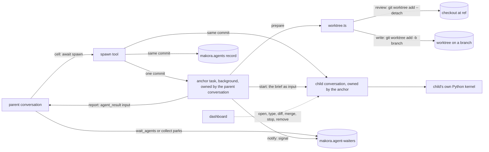

# Subagents

> **Status: built (phase 3).** Code: `apps/makora/src/agents/`. User view: [features/subagents.md](../features/subagents.md).
> Decisions: every subagent gets its own worktree and its own REPL; the dashboard is layout A
> ([decisions.md](../decisions.md)). Open items are listed at the end.

A subagent is a child conversation that works on its own: its own git worktree, its own Python kernel, its own model,
and a budget. The parent starts it from a cell, waits for it without holding a process, and decides what to do with
its result. The user sees and steers every subagent from the agents dashboard ([tui.md](tui.md#the-agents-dashboard)).

## How a subagent runs



```python
await spawn("review-auth", "Review the auth changes for bugs; run the tests.", mode="review")
await spawn("fix-db", "Fix the migration bug.", mode="write", base="main", budget={"usd": 2, "minutes": 30})
results = await collect(["review-auth", "fix-db"])   # or end the cell and call wait_agents
await merge("fix-db")                                # write mode only; conflicts come back as data
```

1. `spawn` (`src/agents/spawn.ts`) checks the name, the depth and the model, resolves `ref` or `base` to a commit, and
   in one commit creates the anchor task, the child conversation and the record. The child starts as a copy of the
   parent's agent, with `cwd` set to its worktree, `maxTurns` set to its turn budget, and the model when one was given.
   Calling `spawn` again with a known name returns that child, so a rerun after a crash never starts a second one.
2. The anchor (`src/agents/anchor.ts`) is a background task owned by the parent conversation, not by the cell. Durable
   aborts the nested calls of a tool call that is not replay-safe when it restarts, and a cell cannot be replay-safe,
   so a child owned by the cell would die with it.
3. The anchor takes a running slot or queues for one, adds the worktree, runs the project's setup command when the user
   approved it, and submits the brief as the child's first input with `notify` set to its own signal key.
4. The child runs like any conversation. Its first `python` call starts its own kernel in the worktree.
5. When the run settles, the anchor stops the child's kernel, records the result, wakes the parent's waits on this
   child, or else reports the result to the parent as an input, and gives back its slot.
6. An input to the finished child (a message, a result from its own child, text the user types) wakes it: the child is
   `queued` again, and the anchor takes a slot as for the first run, submits the input, and watches the new run under
   the same limits.

## Records

Every piece of state lives in Durable documents. Nothing is kept only in a kernel's memory or in the process.

| Document | Scope | Holds |
| --- | --- | --- |
| `makora.agents` | Parent conversation | Its children by name: the `AgentRecord` (`src/agents/types.ts`) and the runtime `{ anchor, round, held }`; `held` is the input that woke a finished child, kept until its anchor has a slot |
| `makora.agent` (family, key `self`) | Child conversation | Its name, its parent's conversation id and its depth, written in the commit that creates it |
| `makora.agent-waiters` | Parent conversation | Its parked `wait_agents` and `collect` calls: names, policy, the signal key, whether messages wake it |
| `makora.agent-slots` | Session | The anchors holding a running slot, and those queued for one, in order |
| `makora.agent-messages` | Session | The newest 200 messages between agents, for the dashboard |
| `makora.agent-rates` | Session | Each sender's message bucket, so the rate limit holds across restarts |

`AgentRecord` is the contract the dashboard reads: name, conversation ids, depth, mode, task, model, worktree, budget,
creation time, and a tagged state: `queued`, `running`, `done` (with the result), `stopped` (with the reason
`user`, `cost`, `time`, `turns`, `error` or `parent`), `merged` (with the merge commit) or `removed`.

Three signals wake parked work: `makora.agent-wake` (a waited-for child finished, or a message arrived),
`makora.agent-control` (stop or remove a child, or an input woke a finished one) and `makora.agent-slot` (a queued
anchor got a running slot).

## The anchor

The anchor is a state machine. Each phase commits its effect together with the next checkpoint:

| Phase | Does |
| --- | --- |
| `queue` | Takes a slot when fewer than `agents.maxRunning` anchors hold one, else queues and sleeps on the slot and control keys. It runs before the first run and before each woken run |
| `dequeued` | Woken by a slot, or by a stop or remove while queued |
| `prepare` | First run only. Adds the worktree and runs the approved setup command, watching the record so a stop or remove kills it; the outcome is memoized, so a crash never runs it twice |
| `notice` | Unless the child was stopped or removed meanwhile, writes the setup outcome into the child's transcript as a `makora.notice` entry. A worktree that could not be added or a failed, timed-out setup stops the child (`error`) in the same commit |
| `tell` | For a setup command that is not approved, writes the same notice, prefixed with the child's name, into the parent's transcript |
| `start` | Submits the brief, or for a woken run the input it holds, under the next round, and sleeps on `settled-<round>` and `control-<round>`, with a deadline when the budget has `minutes`. Every run gets the whole of `minutes` |
| `woke` | Reads which key woke it: the run settled, a stop arrived, or the deadline passed; aborts the child when it stopped. Woken at rest by an input, it moves the child to the next round and back to `queue` |
| `settle` | Stops the child's kernel, commits a write child's work (also when it stopped), and records `done` or `stopped`; a git failure here records `stopped` with `error` |
| `notify` | Signals the parent's waits that include this child, one per commit |
| `report` | When no wait was told, gives the parent the result as an `agent_result` input |
| `release` | Gives back the slot to the first queued anchor, then sleeps on the control key until an input wakes the child, or ends once it is removed |

A Durable commit holds one table write: a second `tx.signal` or a submission after a signal throws `ReadAfterWrite`.
That is why notifying waiters, reporting and releasing are separate phases, and why `notify` loops one waiter per commit.

**No phase throws for git or the setup command.** A phase that throws faults the task, and Durable ends a faulted task
without running its `abort` handler. The anchor would keep its running slot, its record would stay `queued` or
`running`, and every wait on the child would stay parked. Adding the worktree, the setup command and committing the
child's work therefore turn a failure into `stopped` with `error` and its detail, and the anchor goes on to `notify` and
`release`.

**Rounds.** The anchor sleeps on `settled-<round>` and `control-<round>`. Whoever moves a record out of `running` (the
anchor's `settle`, or the `stop` tool) advances the round in the same commit, and so does the anchor when an input
wakes the resting child and it queues again. `start` advances it once more for the run it submits. A stop while a
woken child waits for its slot therefore signals a key of its own, and a signal for an old round finds nobody sleeping
on it.

**Every run takes a slot.** `admitInput` (`src/agents/family.ts`) never submits to a finished child. In one commit it
keeps the input as the child's `held` input, records the child `queued`, and signals its resting anchor with
`{ kind: "wake" }`. The anchor queues for a slot like a first run, and `start` submits the held input with the deadline
of `minutes`. The turn limit is Durable's `maxTurns`, counted per run. Spend in `usd` is the child's `pi.usage`, which
counts every run. A stop while it is queued drops the held input.

## Worktrees and roots

`src/agents/worktree.ts` places and manages a child's files. The git calls shared with forks live in `src/worktrees.ts`.

- **Where.** `<root>/<repo dir>-<8 hex of sha256(repo path)>/<session id>/<child conversation id>/`. Review checkouts
  go under the review root, by default `<os temp folder>/makora-worktrees`. Write worktrees go under the write root, by
  default `~/.makora/worktrees`. Both are set in `settings.json` (`worktrees.review`, `worktrees.write`). A review
  checkout is thrown away anyway, so losing it on a reboot costs nothing. A write agent's unmerged work has to survive
  one.
- **Review mode.** `git worktree add --detach <path> <commit of ref>`. No branch.
- **Write mode.** `git worktree add -b <branch> <path> <commit of base>`, with the branch named
  `makora/<name>-<last 6 characters of the session id>-<child conversation id>`. Conversation ids repeat across
  sessions, so the session part keeps branch names unique.
- **The child's cwd** is the worktree plus the parent's folder relative to its top level, created when git does not
  track it.
- **Outside git** the child shares the parent's folder (`{ kind: "shared" }`), and its changes land there directly.
- **Re-adding.** A worktree whose folder is gone (a cleaned temp folder, a manual delete) is added again before the
  child's first run and, through a `beforeTool` hook on `python`, before its next cell: at the same commit for a review
  checkout, on its branch for a write worktree.
- **Setup command.** `worktreeSetup` in the repository's `.makora/settings.json` runs with `sh -c` in the new worktree
  before the child starts, for example `npm ci --ignore-scripts`. A fresh worktree has no `node_modules` and no
  untracked files such as `.env`.
- **Setup trust boundary.** The command comes with the repository, so it runs only once the user approved that exact
  command for that repository: `agents.approvedSetups` in the user's `settings.json` holds the repository path and the
  command's SHA-256. The session's `SetupPolicy` (`src/session.ts`) checks the settings and otherwise asks through
  `OpenOptions.askSetup`, which the TUI answers with a dialog, once per repository and command until it exits; a yes is
  stored. Print mode has no `askSetup`, so an unapproved command is skipped, the child starts without it, its brief
  says so, and the `notice` and `tell` phases say how to approve it. The command runs in a process group of its own
  without provider credentials in its environment (names ending in `_API_KEY`, `_TOKEN` or `_SECRET`, and the other
  credential variables pi-ai reads). The group is killed after `agents.setupTimeoutMinutes` (default 10) or when the
  record leaves `queued`.
- **Git writes take turns.** Committing a child's work, merging, adding and removing worktrees, and deleting branches
  run through the session's `GitWrites` (`src/git/writes.ts`): one at a time per repository, keyed by its common git
  dir, so the main worktree and every fork's and child's worktree share one queue. Two of them at once failed on the
  lock the other held: removing a write child while its anchor committed its work stopped with `index.lock: File
  exists`. A lock another process holds (the user's own `git commit`) is waited for: `git()` in
  `src/repl/git-tree.ts` tries again after 50, 100, 200, 400, 800 and 1,600 ms, then fails with the lock's path and
  how to clear a stale one. The queue lives on the session and forgets a repository once its writes drained. Cell
  snapshots are not queued: they use a temporary index and their own ref per conversation.

## Limits

| Limit | Default | Enforced by |
| --- | --- | --- |
| Turns | 50 | Durable's `maxTurns` on the child; a run that reaches it stops with `turns` |
| Cost | set per spawn (`usd`) | An `afterTools` hook compares the child's `pi.usage` with the budget after each tool round; past it, the `CostStop` task signals the anchor and ends the run (`cost`) |
| Wall time | set per spawn (`minutes`) | The anchor's sleep deadline, set again for each run; it aborts the child (`time`) |
| Depth | 2 | A child of the root (depth 1) may spawn; its children (depth 2) are configured without the `spawn` tool |
| Running at once | 4 (`agents.maxRunning`) | The `makora.agent-slots` queue; a fifth child, first run or woken, waits as `queued` |
| Message length | 16,384 characters | `send` refuses longer messages |
| Pending inputs per receiver | 20 | `send` refuses when the receiver's inbox has 20 items |
| Message rate | 3 per sender, one more each second | `send` refuses past the bucket |

A stopped child keeps its transcript and worktree until it is removed, so you can see why it stopped. A child holds its
slot while it waits for its own children, so with `agents.maxRunning` at 1 a child that waits for a grandchild never
sees it run.

## Finishing

When the child's run settles with an answer, the anchor records `done` with a result:

- **review:** the final answer as `summary`.
- **write:** makora first commits what the child left uncommitted, as author `makora`, with the subject
  `<name>: <first line of the answer>`. The result adds the branch head and a diff stat against the base commit. The
  commit runs with `core.hooksPath=/dev/null`, `commit.gpgsign=false` and `--no-verify`: the user's hooks and signing
  are for their own commits, and a failing hook or a passphrase prompt must not keep the child from finishing.
- **shared** (outside git): the summary; the changes are already in the parent's folder.

A run that ends without an answer is `stopped`: `turns` at the turn limit, `user` when aborted, `error` otherwise. A
stopped write child's work is committed the same way, as `<name>: unfinished work (stopped: <reason>)`, so its branch
holds everything it did.

The parent hears about it in one of two ways. If a `wait_agents` or `collect` call is parked on the child, the anchor
signals it. Otherwise it gives the parent an `<agent_result name="..." state="...">` input with the summary, branch
head and diff stat, or the stop reason. The root gets it as a follow-up. A parent that is itself a child gets it as a
steer while it runs, or is woken by it once finished, so its own anchor watches that run. A parent that cannot take it
(queued, removed, or finishing its run) keeps the result in the record, where `collect` and `agents.get` read it.

## Messaging

`await send(to, message)` (`src/agents/messaging.ts`) reaches the caller's parent (`"parent"`), a sibling or a direct
child by name, or all of them (`"all"`). The host decides the sender and the relationship from the calling
conversation, never from Python. Each delivery is one commit:

1. If the receiver has a parked `wait_agents` call that wakes on messages, the message is signalled to it and becomes
   that call's result.
2. Otherwise it is admitted as an `<agent_message from="..." relationship="...">` input (`admitInput` in
   `src/agents/family.ts`): the root gets it as a steer while busy and as a new turn when idle; a running child gets a
   steer; a finished child (`done`, `stopped` or `merged`) is woken: it is `queued` until its anchor has a running slot
   and submits the message, unless its budget refuses the wake (below).
3. The message goes into `makora.agent-messages`.

A message to a queued or removed child is refused, a woken one waiting for its slot included, and so is one that
arrives between the end of a child's run and its anchor recording it. A broadcast reports each receiver's outcome and
goes on past a refusal.

**Waking a stopped child.** `admitInput` takes who sends each input: `user`, or the sender's relationship to the
receiver. A child stopped for `cost`, or whose `pi.usage` has reached its `usd`, refuses every wake: the spend check
runs only after a tool round, so each wake would spend at least one more request. A child stopped for `turns` or `time`
wakes only for its parent or the user, who decide that it may go on; siblings and results from its own children are
refused.

Text the user types into an opened child takes the same path as a user input (`MakoraSession.submit` in
`src/session.ts`): a steer while it runs, a wake-up that queues for a slot once it finished, refused while queued or
removed. Its new result is recorded and reported like the first.

## `wait_agents` and `collect`

`wait_agents(names, policy="any"|"all")` is a model tool next to `python`. `await collect(names, timeout=None)` is the
same wait inside a cell. Both live in `src/agents/wait.ts`.

- **Parking.** In one commit the call checks whether the children already finished and, if not, registers itself in
  the parent's `makora.agent-waiters` document with a new signal key per park (`wait-1`, `wait-2`, …). Checking and
  registering together means no child can finish between them. The call then sleeps on that key in Durable, so the
  session holds no process while it waits.
- **Waking.** A finishing child's anchor signals each waiter that includes it. `send` signals a waiter that also waits
  for messages (`wait_agents`, not `collect`), and the message is the tool result.
- **A message that came first.** If a message arrived as a steer before the wait registered, `wait_agents` returns at
  once and says a message is queued, so it never blocks on a message already in the inbox.
- **`collect`'s timeout** is a memoized deadline; at the deadline it returns the records as they are.

## Merge, stop and remove

`src/agents/control.ts` holds the three operations. The tools call them for a cell; the dashboard calls them for the
user through the same functions (`ControlApi` is a tool call's API or the host's harness). Each converges when run
again after a crash.

- **`merge(name)`** runs `git merge --no-ff --no-edit -m "Merge <name> (<branch>)" <branch>` as author `makora` in the
  parent's folder, then records `merged` with the merge commit. It first refuses when the user has an operation in
  progress there (`MERGE_HEAD`, `CHERRY_PICK_HEAD`, `REVERT_HEAD`, or a `rebase-merge` or `rebase-apply` directory):
  aborting it would throw away their resolution, and merging into a stopped rebase would land in the middle of it. So
  a `MERGE_HEAD` after the merge is always this merge's. A conflict runs `git merge --abort` and returns the conflicting
  paths, with the tree as it was. A merge stopped without conflicts (a failing `pre-merge-commit` hook, failed
  signing) is aborted and throws its error. A dirty tree that blocks the merge is the call's error. Only a `done`
  write child merges; merging a merged child returns its merge commit.
- **`stop(name)`**, for a queued or running child: one commit signals the anchor, records `stopped` with the reason,
  and advances the round; then the child's conversation is aborted.
- **`remove(name)`** removes the child's own children first (reason `parent`), stops the child, stops its kernel,
  commits an unmerged write child's leftover work to its branch, deletes its worktree (`git worktree remove --force`),
  deletes its branch when merged and keeps an unmerged one, and records `removed`, which ends the anchor. The dashboard
  hides removed children; Durable keeps their transcripts.

**Deleting the session.** `makora rm <id>`, and an ephemeral session as it closes, remove every child's worktree
(`src/session-delete.ts`). It reads the records of every conversation (`makora.agents`, `makora.fork`), with a
read-only harness for a stored session, so no work resumes. A write branch stays while it holds work: changes its
worktree left uncommitted, which are committed to it first as `<name>: unfinished work (session deleted)`, or commits
beyond its base that were not merged (recorded `merged`, or reachable from the repository's `HEAD`). A branch without
either is deleted. Then it prunes each repository, deletes `refs/makora/<session>/`, and removes the session's empty
folders under the worktree roots. A worktree outside `<root>/<repo dir>/<session>/` of a root the settings name now is
left alone. Each step converges, so running it again after a crash or a cleaned temp folder finishes the job.

## Crash safety

- The child, its anchor and its record are created in one commit, and `spawn` returns an existing name's child.
- Each anchor phase commits its effect with its checkpoint; a crash reruns at most the side effects that converge: git
  calls, kernel stops and conversation aborts. The setup command's outcome is memoized.
- Kernels a crashed process left running are killed by their pid files on the next open, as for every conversation
  ([repl.md](repl.md#when-makora-itself-dies)); a child's next cell restores its variables.
- A review checkout deleted while makora was down comes back before the child's next cell.

`test/agents-crash.test.ts` kills a session with children mid-run, reopens it, and checks that nothing ran twice and
that a deleted review checkout came back.

## Tools

The `makora-agents` extension (`src/agents/extension.ts`) registers:

| Tool | Callers | Does |
| --- | --- | --- |
| `spawn` | cells (`await spawn(...)`) | Create a child, or return the one with that name |
| `collect` | cells | Wait until every named child finished, or the timeout |
| `send` | cells | Message the parent, a sibling, a child, or all |
| `merge`, `stop`, `remove` | cells | See [Merge, stop and remove](#merge-stop-and-remove) |
| `agents` | cells (`agents.list()`, `agents.get(name)`, `agents.recent(name, limit=6)`) | Read the caller's children's records and recent messages |
| `wait_agents` | the model | Park until one or all named children finish, or a message arrives |

It also registers the anchor and `CostStop` tasks, the `beforeTool` hook that re-adds a missing worktree, and the
`afterTools` hook that checks spend. Cells reach the tools through the `agents` host method
([repl.md](repl.md#host-calls)).

## The dashboard

Ctrl+A opens it. It lists the main conversation, its forks and every subagent in sections RUNNING, WAITING ON YOU (done
write agents not merged yet) and DONE, with an inspector for the selected agent; `d`, `m`, `s` and `x` diff, merge,
stop and remove, and Enter opens the agent in the main screen. What the user sees:
[features/subagents.md](../features/subagents.md#the-dashboard). How it is built: [tui.md](tui.md#the-agents-dashboard).

## What is still open

| Item | Today |
| --- | --- |
| Re-adding a missing worktree before a later cell | Does not rerun the setup command |
| Cost limit | Checked after each tool round, so a run's final answer is never cut off and one long response can pass the budget |
| `agents.list()` | Lists only the caller's children; a child learns its siblings' names from its brief |
| Model roles (pstack's code and judgment models as a setting) | Not built; `spawn(model=...)` picks a model per child |
| `interrogate` and `swarm` running real subagents | Not tried end to end |
| `ctx.get(name)` for child results in a cell | Not built; `agents.get(name)` returns the record |
| Kernel startup cost per subagent (a process plus a restore) | Not measured |
| A live view of a running agent inside the dashboard | Waits until pi-tui can route keys to a second scrolling area; Enter opens the agent in the main screen instead |
