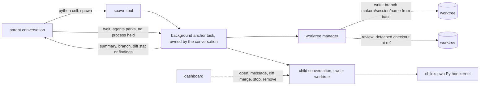

# Subagents (phase 3, planned)

> **Status: designed, not built.** Depends on the REPL ([repl.md](repl.md)). Decisions: every subagent gets its own
> worktree and its own REPL; the dashboard is layout A ([decisions.md](../decisions.md)).

A subagent is a child conversation that works on its own: its own git worktree, its own Python kernel, its own model,
and a budget. The parent creates it from a REPL cell, waits for it without holding a process, and decides what to do
with its result. You see and steer every subagent from the agents dashboard.

## How a subagent runs



```python
await spawn("review-auth", "Review the auth changes for bugs; run the tests.", mode="review", ref="HEAD")
await spawn("fix-db", "Fix the migration bug.", mode="write", base="main", budget={"usd": 2, "minutes": 30})
results = await collect(["review-auth", "fix-db"])   # or end the cell and call wait_agents
await merge("fix-db")                                # write mode only; conflicts come back as data
```

1. `spawn` calls the `spawn` tool through Durable, keyed by the child's name, so calling it again after a crash
   reattaches instead of starting a duplicate.
2. The tool creates a background anchor task owned by the conversation, not by the cell: a crashed cell does not
   take its children with it.
3. The worktree manager creates the worktree, runs the project's setup command if one is configured, and records it.
4. Under the anchor, a child conversation is created with `cwd` set to the worktree, its model and thinking level,
   and its turn limit. Its first `python` call starts its own kernel there.
5. The parent waits with `wait_agents` (a parked tool: no process held while waiting) or `collect`.
6. When the child finishes, the anchor stores its result: a summary plus findings (review) or a branch and diff stat
   (write).

## Modes

| Mode | Worktree | Returns | Afterwards |
| --- | --- | --- | --- |
| `review` | `git worktree add --detach <path> <ref>`: the commit under review, no branch | Findings | Removing the agent deletes the worktree; anything it changed is discarded |
| `write` | New branch `makora/<session>/<name>` from `base` | Summary, branch, diff stat | `merge(name)` merges the branch into the parent's tree; conflicts come back as data. Removing the agent deletes the worktree and, unless merged, keeps the branch |

Worktrees live outside the repository, at `~/.makora/worktrees/<repo>/<session>/<name>`, so tools that walk the
project (tsc, biome, test globs, `rg`) never wander into a child's checkout.

A fresh worktree has no `node_modules` or untracked files such as `.env`. A project can set a setup command in
`.makora/settings.json` (for example `npm ci --ignore-scripts`) that runs when a worktree is created.

## Limits

| Limit | Default | Enforced by |
| --- | --- | --- |
| Turns | 50 | Durable's `maxTurns` on the child conversation |
| Cost | set per spawn | The anchor watches the child's `pi.usage` and stops it |
| Wall time | set per spawn | A Durable timer on the anchor that stops the child |
| Depth | 2 (a child may spawn children once) | `spawn` refuses beyond it |
| Running at once | 4 | Further spawns wait in order |

A stopped child keeps its transcript and worktree until removed, so you can see why it stopped.

## Tools

| Tool | Does |
| --- | --- |
| `spawn(name, task, mode, ref/base, model?, budget?)` | Create a child, or reattach to the one with that name |
| `send(name, message)` | Steer a running child or follow up on a finished one |
| `collect(names, timeout?)` | Wait inside a cell and return results |
| `wait_agents(names, policy)` | End the cell and park until one or all finish (model tool) |
| `merge(name)` | Merge a write-mode child's branch; returns conflicts |
| `list_agents()` | Names, modes, states, budgets |

State lives in Durable: each child is a conversation owned by its anchor task, and a `makora.agents` document on the
parent conversation records name, mode, worktree path, branch or ref, budget, and result. Nothing is kept only in a
kernel's memory.

## The dashboard

Layout A, opened with Ctrl+A ([features/tui.md](../features/tui.md)):

- **List** in sections RUNNING, WAITING ON YOU (finished write children ready to merge), DONE (including stopped).
  Each row: name, mode, branch or `@ref`, model, a budget bar, cost, age, current cell. Children indented under
  their parent.
- **Inspector** for the selected agent: mode and base, kernel state (running, restored, dead) and variable count,
  cost, time and turn budgets, its recent cells, and the worktree's diff stat and path.
- **Keys**: Enter opens the agent in the main screen, `d` diff, `m` merge, `s` stop, `x` remove, Esc back.
- **Opened agent**: the main screen shows its transcript and cells under a banner `viewing <name> · <mode> ·
  <branch> · esc back to main`; what you type goes to that agent. The status row shows its model and worktree.

The list already comes from Durable's task graph, so children appear without changes to how it loads.
