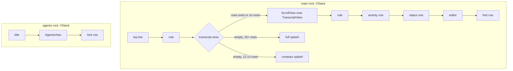

# TUI internals

`apps/makora/src/tui/`. What the user sees: [features/tui.md](../features/tui.md).

## Pieces

| File | Owns |
| --- | --- |
| `run.ts` | The composition root: builds both screens, opens and switches sessions, routes keys and commands, the ticker |
| `session-feed.ts` | The live model of the open session: watches the root conversation, the transcript window, the task graph, and derived numbers (cost, context tokens, counts) |
| `ui-state.ts` | The TUI's own state as a reducer: which view, the selected agent, expanded tool cells |
| `transcript-view.ts` | Draws feed rows: messages, markdown, thinking, tool summaries or expanded cells, notices |
| `bars.ts` | One-row bars: top bar, activity row, status row, hints, rules |
| `splash.ts` | The empty-transcript splash: full (wheel + wordmark) and compact (small wheel) variants |
| `agents.ts` | The agents view and loading its rows from the task graph and conversation scan |
| `dialogs.ts` | Modal selector and text input overlays used by commands and login |
| `commands.ts` | The slash command table, autocomplete entries, login and account flows |
| `keybindings.ts` | Makora's bindings merged over pi-tui's, plus user overrides |
| `account-label.ts` | The status row's account label |
| `rounded-editor.ts` | pi-tui's editor drawn in a rounded box |
| `theme.ts` | The one dark theme |

## Layout

Two layout roots on a `TuiAltScreen`; `run.ts` swaps them with `setLayoutRoot`:

The transcript area holds three stack entries whose `visible` callbacks pick exactly one, from the feed's row count and
the viewport height minus the 9 rows of chrome. Each splash sits in an `HStack` with `align: "center"`, which centers
it vertically (the cross axis of a horizontal stack). The full splash falls back to the wheel alone when the width is
below wheel + gap + wordmark.

## Data flow

1. `SessionFeed` calls `root.watch()` (Durable) and turns each value into rows with `transcript-rows.ts`: committed
   entries plus the streaming partial message and tool slots from the `pi.live` document.
2. Older entries come from `ConversationTranscript` when the user scrolls to the top.
3. `harness.watchTaskGraph()` gives running and waiting counts and the agents view's rows.
4. Cost, model and context tokens are derived on a 250 ms debounce. The timer is cleared on `stop()`, and rejections
   after a session closes are ignored, so switching sessions mid-run cannot crash the process.
5. A 125 ms ticker re-renders spinners and elapsed times; plan usage refreshes every 5 minutes.

Local lines (command output `·`, notices `⚠`) are added to the feed but not to Durable, so they are not saved.

## Keys

`run.ts` registers one input listener that runs before the focused component. On the main screen without an overlay,
it walks the `APP_KEYS` table (`app.interrupt`, `app.exit`, `app.cancel`, `app.tools.expand`, `app.agents`,
`app.model.select`); an action returning `false` lets the key through to the editor. Bindings are never matched by
literal key strings: `keybindings.ts` declares makora's ids and defaults, merges them over pi-tui's `TUI_KEYBINDINGS`
in a `KeybindingsManager`, and applies `~/.makora/keybindings.json` (validated; bad entries skipped).

Ctrl+C (`cancel`) stops a busy run, else clears the editor, else arms a 1.5 s window in which a second press exits;
it always requests a render, because the editor's `setText` does not.

## Errors

Every promise started from a timer or key handler has a rejection handler: a corrupt `auth.json` shows as `auth file
unreadable` in the status row, failed loads show a notice, and agent-row loads that fail are retried by the next poll.
