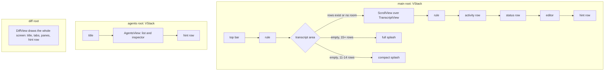

# TUI internals

`apps/makora/src/tui/`. What the user sees: [features/tui.md](../features/tui.md).

## Pieces

| File | Owns |
| --- | --- |
| `run.ts` | The composition root: builds the three screens, opens and switches sessions, keeps the active conversation and one feed per conversation shown, routes keys, commands and session notices, runs the dashboard's actions, the ticker |
| `session-feed.ts` | The live model of one conversation of the open session: watches it, the transcript window, the task graph, its kernel status (`session.kernels`), its fork record or subagent record (read once, for the top bar), and derived numbers (cost, context tokens, counts) |
| `ui-state.ts` | The TUI's own state as a reducer: which view (main, agents, diff, and the screen the diff view returns to), the selected agent, expanded tool cells |
| `transcript-view.ts` | Draws feed rows: messages, markdown, thinking, tool summaries or expanded cells (a python cell's code, output tail and nested calls), subagent results and messages (`↩`), notices |
| `bars.ts` | One-row bars: top bar with the `viewing …` label, activity row with the kernel label (`kernelLabel`), status row, hints, rules; `fitStart` for paths |
| `splash.ts` | The empty-transcript splash: full (wheel + wordmark) and compact (small wheel) variants |
| `agents.ts` | The agents dashboard's view, and `loadAgents`: every conversation's `AgentFacts` from Durable (fork record, subagent record, `pi.live`, `pi.usage`, newest entries) and the message log; `countWorktrees` for the activity row. The list is drawn through `list-window.ts` |
| `list-window.ts` | Which list lines fit the rows the list has: scrolled by the least that keeps the selected row in view, the top section's title kept, `↑ N more` / `↓ N more` for rows cut off |
| `dashboard.ts` | The dashboard's pure model: `dashboardRows` (sections, indentation, glyph state, mode, branch or ref, budget bar, running cell) and `inspectorLines` |
| `agent-actions.ts` | What `d`, `m`, `s` and `x` do to the selected agent, with their confirmations, through `src/agents/control.ts` |
| `dialogs.ts` | Modal selector and text input overlays used by commands and login, and `show` for a command's own overlay component |
| `commands.ts` | The slash command table, autocomplete entries, login and account flows, the `/fork` picker, `/pstack` with its model, thinking, budget and reset dialogs; `/skill:setup-pstack` runs `/pstack` |
| `pstack-picker.ts` | The `/pstack` overlay: tiers and roles drawn through `list-window.ts`, Enter, the seat editing of panel roles, `b` and `r`; it hands the edited `PstackConfig` back on Esc |
| `keybindings.ts` | Makora's bindings merged over pi-tui's, plus user overrides |
| `account-label.ts` | The status row's account label |
| `rounded-editor.ts` | pi-tui's editor drawn in a rounded box |
| `theme.ts` | The one dark theme |
| `diff-view.ts` | The full-screen diff view: loading per tab, layouts, keys, stage/unstage/revert, the revert confirm |
| `diff-state.ts` | The diff view's state as a reducer: tabs (with a `since` tab of the working tree against a commit), tab contents, focus, selection, cursor, scroll, side by side, folds |
| `diff-doc.ts` | The diff pane's rows for one file, side by side, or stacked files; the per-file row cap |
| `diff-ask.ts` | The block `a` inserts into the editor |

## Layout

Three layout roots on a `TuiAltScreen`; `run.ts` swaps them with `setLayoutRoot`:

The transcript area holds three stack entries whose `visible` callbacks pick exactly one, from the feed's row count and
the viewport height minus the 9 rows of chrome. Each splash sits in an `HStack` with `align: "center"`, which centers
it vertically (the cross axis of a horizontal stack). The full splash falls back to the wheel alone when the width is
below wheel + gap + wordmark.

## Data flow

1. The active conversation's `SessionFeed` calls `conversation.watch()` (Durable) and turns each value into rows with
   `transcript-rows.ts`: committed entries plus the streaming partial message and tool slots from the `pi.live`
   document. Feeds of conversations shown earlier keep watching, so switching back keeps their local lines; all stop
   when the session closes. Forks: [forks.md](forks.md#switching).
2. Older entries come from `ConversationTranscript` when the user scrolls to the top.
3. `harness.watchTaskGraph()` gives the running and waiting counts. The agents dashboard reads Durable again every
   second while it is open ([The agents dashboard](#the-agents-dashboard)), and the activity row's worktree count is
   read again every second while it is not.
4. Cost, model and context tokens are derived on a 250 ms debounce. The timer is cleared on `stop()`, and rejections
   after a session closes are ignored, so switching sessions mid-run cannot crash the process.
5. A 125 ms ticker re-renders spinners and elapsed times; plan usage refreshes every 5 minutes.

Local lines (command output `·`, notices `⚠`) are added to the feed but not to Durable, so they are not saved.

## Keys

`run.ts` registers one input listener that runs before the focused component. On the main screen without an overlay,
it walks the `APP_KEYS` table (`app.interrupt`, `app.exit`, `app.cancel`, `app.tools.expand`, `app.agents`,
`app.model.select`, `app.diff`); an action returning `false` lets the key through to the editor. `app.back` comes before
`app.interrupt` and shares its default key: on a fork or subagent it makes the main conversation active again, and on
the main conversation it returns `false`, so the same key interrupts. The dashboard reads `tui.select.*` and
`app.agents.diff`, `app.agents.merge`, `app.agents.stop` and `app.agents.remove` itself; the `/pstack` picker reads
`tui.select.*` and the `app.pstack.*` ids. Bindings are never
matched by literal key strings: `keybindings.ts` declares makora's ids and defaults, merges them over pi-tui's
`TUI_KEYBINDINGS` in a `KeybindingsManager`, and applies `~/.makora/keybindings.json` (validated; bad entries
skipped).

Ctrl+C (`cancel`) stops a busy run, else clears the editor, else arms a 1.5 s window in which a second press exits;
it always requests a render, because the editor's `setText` does not.

## The diff view

`/diff` and `app.diff` swap the layout root to `DiffView`, like the agents dashboard; it sets `capturesViewportInput` so
its own keys (`app.diff.*`) reach it before pi-tui's scrolling. Data comes from `src/git/`:

| File | Owns |
| --- | --- |
| `git/repo.ts` | Runs git with `execFile` (no shell) at the repository's top level, with config that could change the output neutralized (`-c core.quotepath=false`, `--literal-pathspecs`, and for diffs `--no-color`, `--no-ext-diff`, `--no-relative`, `-M`, fixed `a/` `b/` prefixes); the five sources (unstaged plus untracked, staged, the merge base with the base branch against the working tree, the working tree plus untracked files against a commit (`filesSince`), the newest 300 commits) and stage, unstage, revert; choosing the base branch |
| `git/diff.ts` | The pure unified-diff parser: `DiffFile` (with a tagged body: text with hunks, binary, or omitted), `Hunk`, `DiffLine` (tagged context/add/del with line numbers); renames, binary, no-newline, quoted paths; untracked files as one added hunk |
| `git/log.ts` | `Commit` and the `git log --numstat` parser |

Results that arrive after the user moved to another tab or file are dropped. The layout follows the width: B (one
stacked scroll) below 100 columns, C (side by side) from 120 columns when toggled, A otherwise. `a` closes the view
and calls the editor's `insertTextAtCursor` with the block from `diff-ask.ts`.

## The agents dashboard

`app.agents` swaps the layout root to the agents root. While it is open, the ticker calls `loadAgents`
(`tui/agents.ts`) every second. It scans the session's conversations and keeps those that are the root, a fork (a
`makora.fork` document) or a subagent (a `makora.agent` document, with its record from the parent's `makora.agents`).
For each it reads the agent's model and cwd, `pi.live` (a run in progress, and the live tool slots), `pi.usage`, and the
newest 200 entries, which give the turn count, the time of the first and last entry, and the python cells through
`transcriptRows`. It also reads the session's `makora.agent-messages` log.

`dashboardRows` (`tui/dashboard.ts`) turns those facts into rows at each render, so times move between reads:

- A subagent's state comes from its record: `queued` and `running` go to RUNNING, a `done` write result to WAITING ON
  YOU, other `done` results, `merged` and `stopped` to DONE, `removed` is left out. The root and forks are RUNNING
  while `pi.live` has a run, which includes a run parked in `wait_agents`, and DONE otherwise.
- Rows are ordered by section, then depth first through the ownership tree (a subagent's parent, a fork's original).
  A row is indented once for each ancestor listed in the same section, so a child whose parent is in another section
  starts at the left edge.
- The budget bar measures `usd`, else `minutes` (time worked), else `turns`. Any use fills one of its 5 cells; a spent
  budget fills all five in the warning color.

`inspectorLines` draws the selected row. The kernel line comes from `session.kernels.status`. The worktree's changes
are read only for the selected subagent, after each load and on each move: `filesSince` against the base commit in its
worktree, summed. Both pure functions have unit tests in `test/dashboard.test.ts`.

The keys run `tui/agent-actions.ts` on the selected row. Each action re-reads the record before it acts, because the
dashboard's copy can be a second old, then asks for confirmation through `Dialogs.select`. `m`, `s` and `x` call
`mergeAgent`, `stopAgent` and `removeAgent` from `src/agents/control.ts`, the same functions the cell tools use, over
the session's harness. The outcome shows in the hint row. Conversations an action removed lose their feeds, and when
the active conversation was one of them, the root becomes active. `d` opens the diff view with a `since` tab at the
subagent's base commit (a fork's at its fork point), and the diff view's Esc returns to the dashboard: `ui-state.ts`
keeps the screen the diff view was opened from.

Enter makes the selected conversation the active one (`activate`, as for forks). The top bar's `viewing …` label comes
from the feed's fork or subagent record. Input typed there goes through `MakoraSession.submit`, which admits a
subagent's input under its anchor's round ([subagents.md](subagents.md#messaging)).

## Errors

Every promise started from a timer or key handler has a rejection handler: a corrupt `auth.json` shows as `auth file
unreadable` in the status row, failed loads show a notice, dashboard reads that fail are retried by the next poll, and
a dashboard action that fails shows its error in the hint row.
